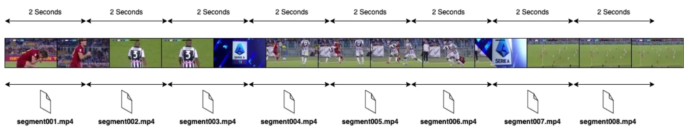
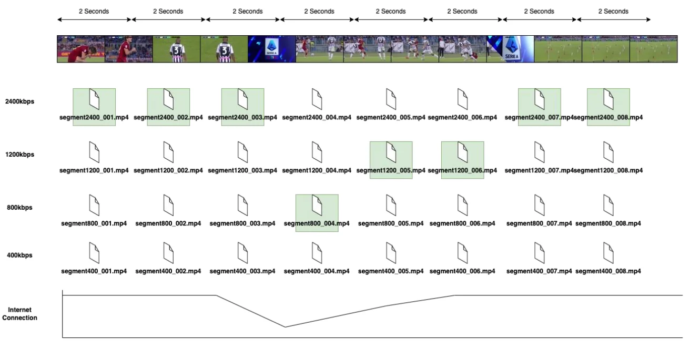
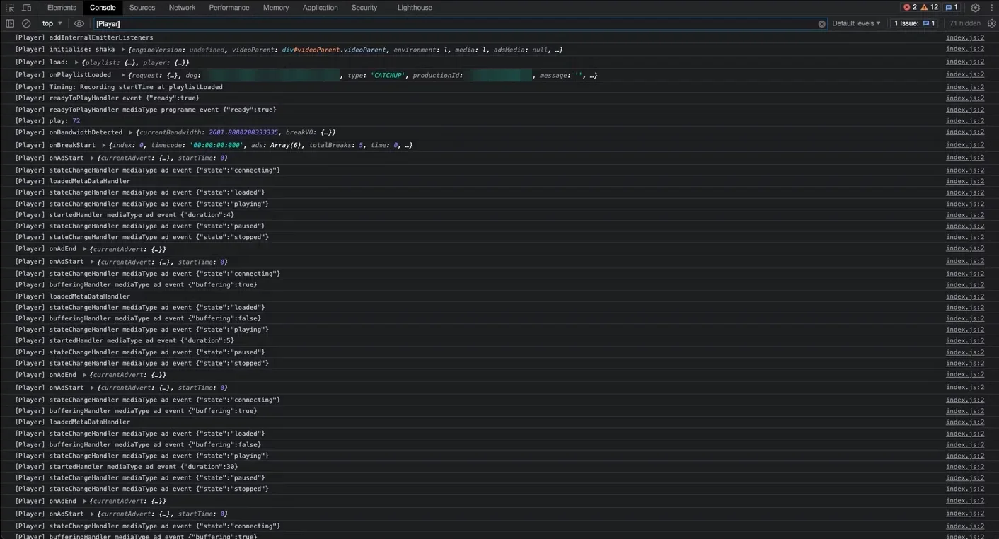
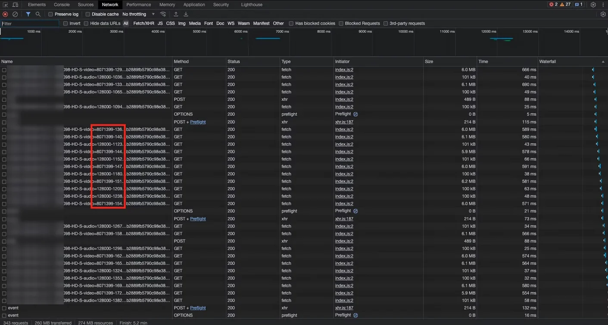
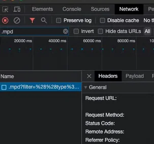
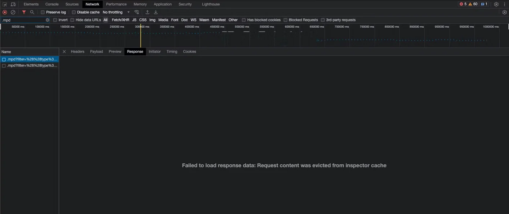
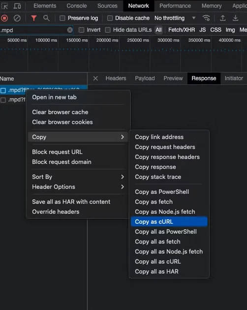
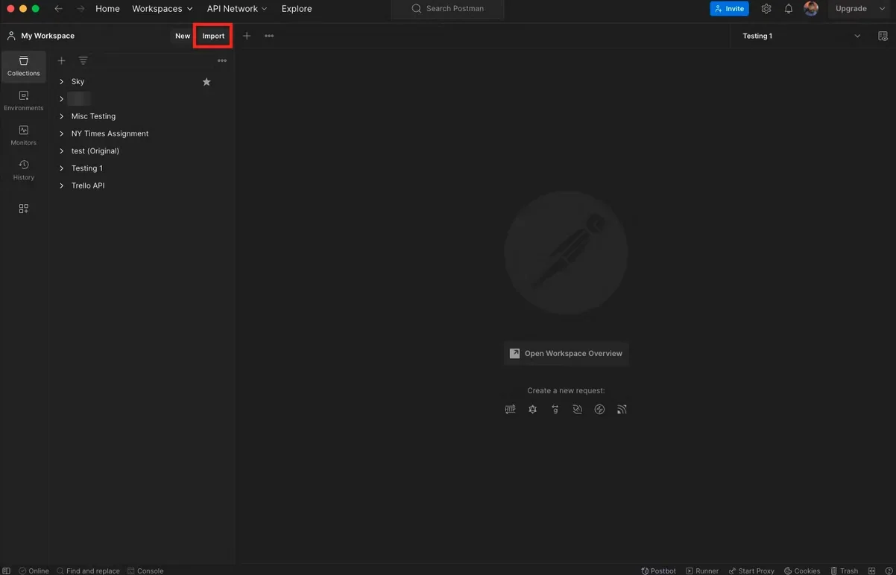
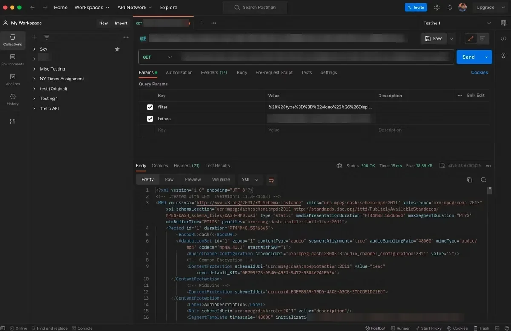
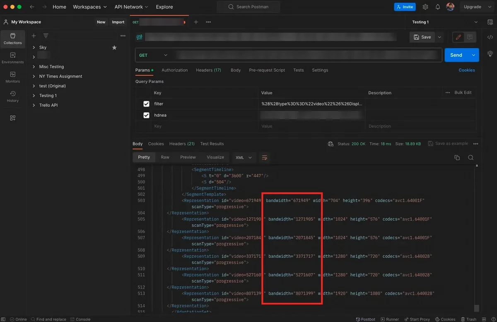

# Adaptive Bitrate & Testing Achieved Resolution

**ABR** stands for Adaptive Bitrate.

## What is video streaming?

A video stream is made up of lots of short segments (for example, 2 seconds each), also called chunks. When the player plays them in the right sequence, they appear to be one continuous video.

## Adaptive bitrate

Each segment is encoded at several bitrates and resolutions. The player picks the best one it can download in time, and switches up or down as network conditions change.

**Manifest:** an index file that tells the player what the segment files are called, which bitrates and resolutions are available, and the order to play them in.

## How do you determine the resolution being played?

Start by connecting to the device's DevTools and opening the **Console** tab. If the device logs media events, you should see something similar to this:

It doesn't matter if these aren't visible, because you only need the network logs to verify the achieved resolution. Start video playback, open the **Network** tab, and watch the segment requests. Each audio and video segment URL includes a track number.

Next, inspect the manifest. Filter the Network tab for `.mpd` and select the matching request.

Open the **Response** tab. You may see a message instead of the manifest content:

This happens when the response is longer than DevTools can display.

To view the full response in Postman instead, right-click the request and choose **Copy as cURL**:

In Postman, select **Import** and paste the cURL command:

Select **Send** to see the response:

The response lists each track (representation) with its resolution:

Compare these track numbers with the ones in the video segment URLs to see which resolution is being achieved. In the example above, playback is at 1080p.
