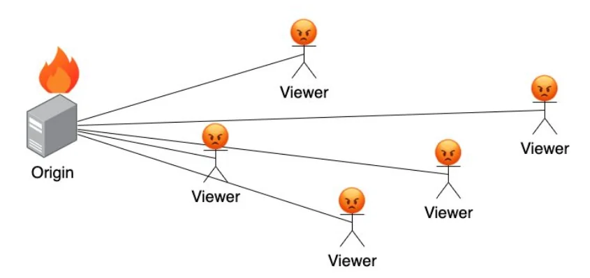
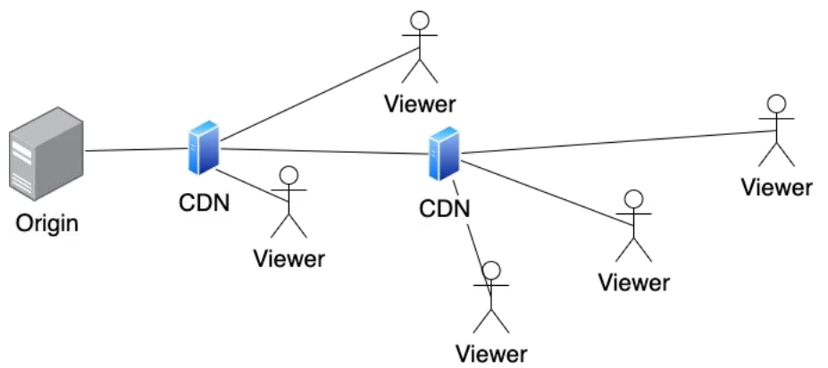
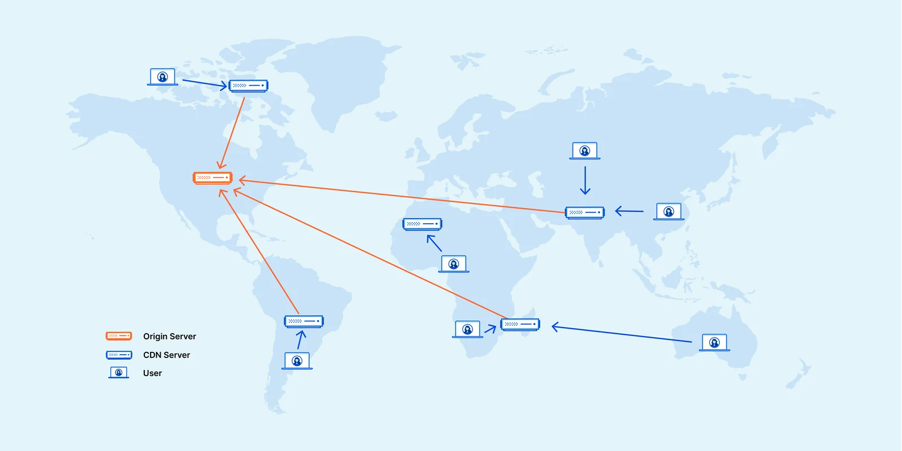

# CDNs & How They Work

**CDN** stands for Content Delivery Network.

## The problem

- Your player downloads the segments that make up a video stream from a web server, which the video is pushed into.
- If there were only one web server, every viewer would have to request segments from it.
- Depending on how popular the content is, that server probably couldn't cope with the number of viewers.

## The solution

- Instead of overloading the origin server, additional servers are placed between the origin and the viewers. These servers request segments from the origin only when they need them.
- They store (cache) each segment they fetch. When other viewers ask for the same segment, they are served the cached copy.
- In practice you need thousands of these caching servers spread around the world. A network of them is called a Content Delivery Network.

### Example

## Benefits of using a CDN

1. Better performance, because content is served from a server close to the viewer
2. Lower bandwidth costs at the origin
3. Higher availability, because other servers can take over if one fails
4. [Improved security](https://www.cloudflare.com/en-gb/learning/ddos/ddos-mitigation/), such as absorbing DDoS attacks
5. Scalability for large audiences

## Examples of CDNs

- [Cloudflare](https://www.cloudflare.com/en-gb/application-services/products/cdn/)
- [Akamai](https://www.akamai.com/solutions/content-delivery-network)
- [Fastly](https://www.fastly.com/products/cdn)
- [Amazon CloudFront](https://aws.amazon.com/cloudfront/)
