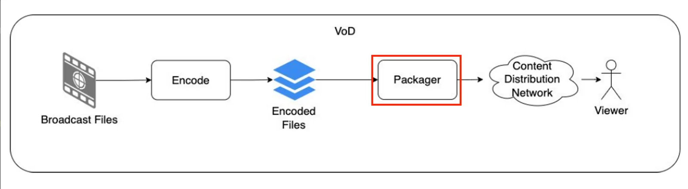
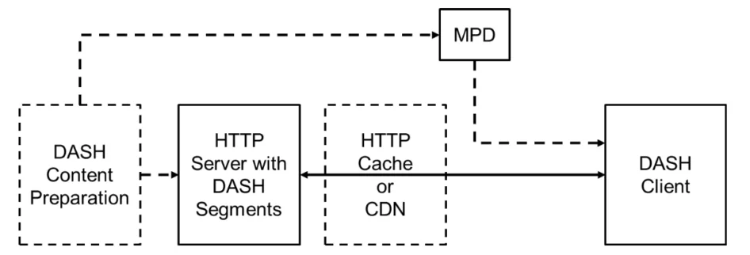

# DRM

**DRM** stands for Digital Rights Management.

- Studios license content to streaming providers only if it is protected, so providers have to apply security measures to it.
- DRM covers a few approaches to protecting content. In its simplest form, the video is encrypted so that only people who have signed in to a service can decrypt it. The player is given short-lived licences that let it decrypt the content. This all happens in the background, and the viewer shouldn't notice it.
- Not all devices support the same DRM systems, so services use several. This adds to the complexity of preparing content that plays on as many device types as possible.
- Encryption is applied at the **packaging** stage shown below. Doing it there means the same encoded video can be packaged once for each streaming format and DRM system, rather than encoded again.

## Streaming formats

- **DASH:** Dynamic Adaptive Streaming over HTTP (MPEG-DASH)
- **HLS:** HTTP Live Streaming, created by Apple
- **HDS:** HTTP Dynamic Streaming, Adobe's format for Flash. It is deprecated, and you're unlikely to meet it on current devices.

### Differences between DASH and HLS

1. **Codecs:** MPEG-DASH is codec-agnostic. HLS supports the codecs Apple specifies, mainly [H.264](https://www.cloudflare.com/learning/video/what-is-h264-avc/) and H.265 (HEVC). Manifest files are `.mpd` for DASH and `.m3u8` for HLS.
2. **Device support:** Apple's native players only play HLS, and FairPlay content is normally delivered over HLS, so HLS is the format to use for Apple devices. DASH can still play on Apple hardware through a JavaScript player (such as Shaka) using Media Source Extensions. That includes Safari on macOS and iPadOS, and Safari on iPhone from iOS 17.1 via Managed Media Source.
3. **Segment length:** Apple recommends 6-second segments for HLS. DASH segments are commonly 2–10 seconds.
4. **Standardisation:** MPEG-DASH is an international standard (ISO/IEC 23009-1). HLS is published by Apple as IETF [RFC 8216](https://datatracker.ietf.org/doc/html/rfc8216), which is informational rather than a formal standard, but HLS is still very widely used.

### DVB-DASH

DVB-DASH is a subset of MPEG-DASH with a few extensions, plus a set of requirements for the DASH player on the client. It is used by broadcasters for connected TVs.

## DRM systems

1. **Widevine:** Google
2. **PlayReady:** Microsoft
3. **FairPlay:** Apple
4. **WisePlay:** Huawei (used on HarmonyOS)

## Security levels

### [PlayReady](https://learn.microsoft.com/en-us/playready/overview/security-level)

| Security level | Purpose | Client implementation | Version |
| :--: | :-- | :-- | :--: |
| SL150 | Clients under development or test. Not suitable for commercial content. | Any implementation is acceptable. Assets, client secrets, and content secrets are not protected against unauthorised use. | Any |
| SL2000 | Hardened devices and applications playing commercial content. | Devices and applications. Assets, client secrets, and content secrets are protected by software or hardware. | Any |
| SL3000 | Hardened devices with the highest security, playing the highest-quality commercial content. | Devices only. Assets, client secrets, and content secrets are protected by hardware, using the processor's Trusted Execution Environment (TEE). Meets a superset of the Compliance and Robustness requirements. | PlayReady 3.0 or higher |

### [Widevine](https://www.widevine.com/solutions/widevine-drm)

Widevine has three security levels: L1, L2, and L3.

- **L1** gives the strongest protection: decryption and video processing happen inside a Trusted Execution Environment. Content owners usually require L1 for premium content such as HD and Ultra HD.
- **L2** decrypts inside the TEE but processes video outside it. It is rare in practice.
- **L3** does everything in software. Services typically limit L2 and L3 devices to SD, whatever the subscription plan or the device's capabilities. The exact limit is set by each service's licence policy.
