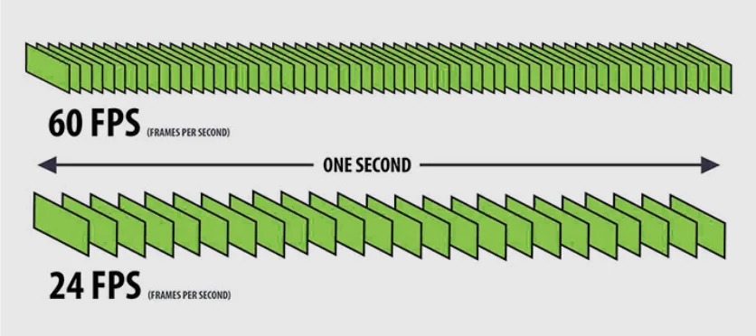

# Frame Rate

**FPS** stands for frames per second.

## What is frame rate?

Frame rate is how often consecutive images (frames) are captured or displayed. It is measured in frames per second: the number of frames recorded in each second of video.

## Common frame rates

| Frame rate | Typical use |
| :--: | :-- |
| 24 FPS | The standard for film and cinematic video. |
| 25 / 50 FPS | Broadcast TV in PAL regions such as the UK and Europe. |
| 30 FPS | Most online content, and broadcast TV in NTSC regions such as the US (strictly 29.97 FPS). |
| 60 FPS | Fast-moving content, such as sport and games, where smooth motion and sharp detail matter. |
| 120 FPS | Slow motion: footage can be slowed down a lot while still playing back smoothly. |

## Challenges

- **Smoothness versus realism:** higher frame rates look smoother, but can make film look like video (the "soap opera effect").
- **File size and bandwidth:** more frames per second means more data to encode, store, and stream.
- **Playback compatibility:** not every device or display can play high frame rates. Some TVs drop frames or play stutteringly when the content frame rate doesn't match the display's refresh rate.
- **Editing and post-production:** high-frame-rate footage takes more storage and processing power to edit.
- **Conversion:** converting between frame rates, for example 24 to 25 FPS or 50 to 60 FPS, can cause judder, dropped or duplicated frames, or a change in audio pitch.
