# Apple TV with Charles Certificate (Supervised)

This guide supervises an Apple TV with Apple Configurator, then installs a profile that sends the device's traffic through Charles Proxy and trusts the Charles certificate.

## Prerequisites

- Charles running with all the rewrites you need. Leave it running throughout this process.
- The Charles root certificate saved as a `.cer` file.
- Your Mac's IP address (in Charles, select **Help → Local IP Address**).
- A Mac with [Apple Configurator](https://apps.apple.com/app/apple-configurator/id1037126344) installed.
- A USB-C cable if you have an Apple TV HD (4th generation).

## Step 1: Reset the Apple TV

1. Open **Settings**.

   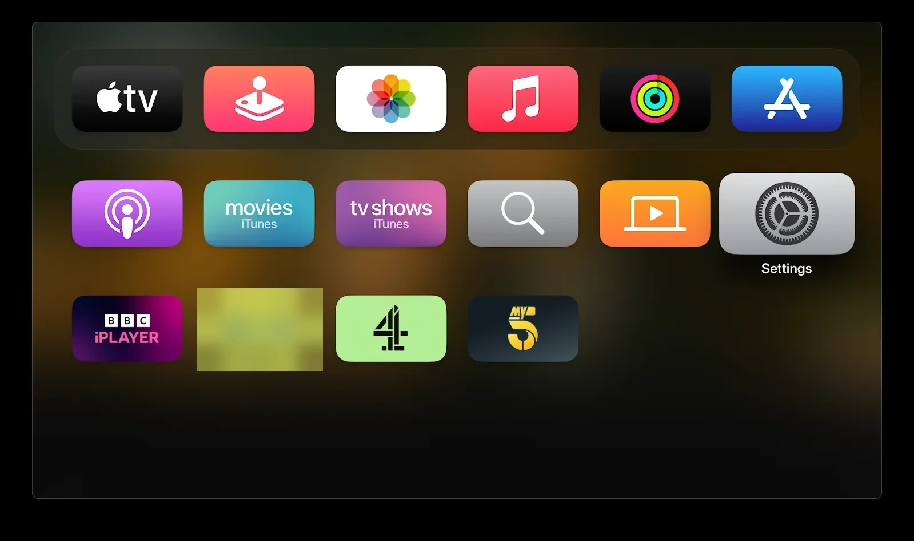

2. Select **System**.

   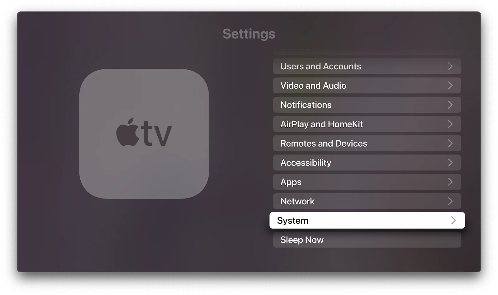

3. Select **Reset**.

   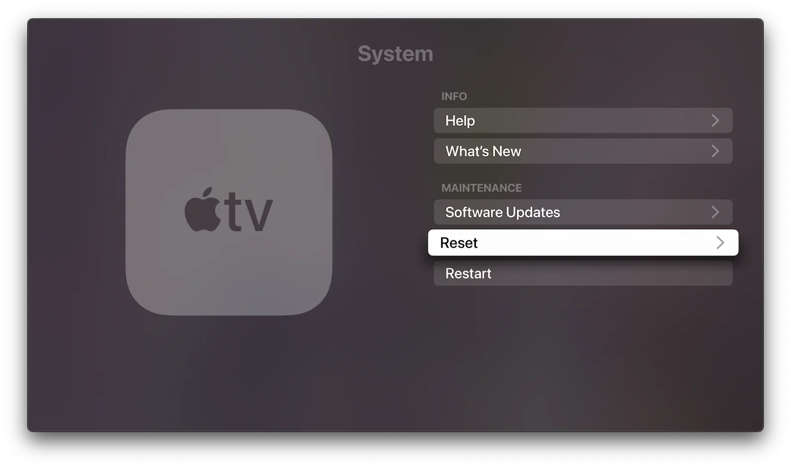

4. Select **Reset and Update**.

   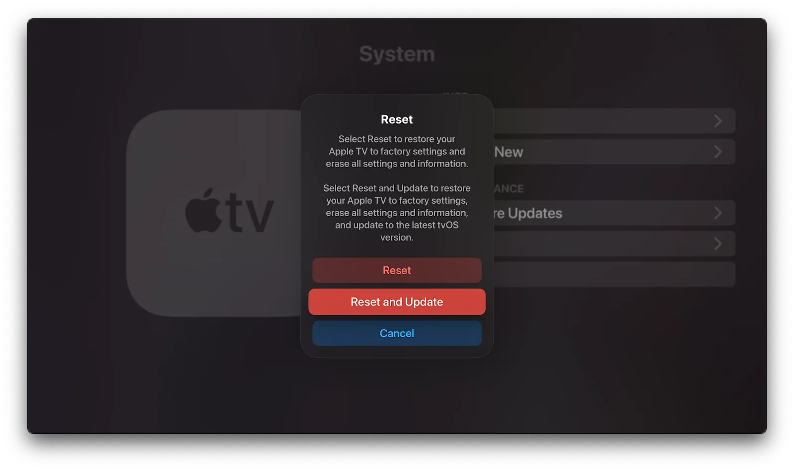

**Reset and Update** takes 20 minutes or more. A plain **Reset** sometimes works on an Apple TV HD, but rarely on an Apple TV 4K. In most cases, if the device has been set up once before, a plain **Reset** is enough.

## Step 2: Supervise the device

:::warning
After the reset finishes, **leave the Apple TV on the Hello screen**. Don't start setting it up yet.
:::

1. Open Apple Configurator on your Mac.
2. Connect the Apple TV:
   - **Apple TV HD:** connect it to your Mac with a USB-C cable.
   - **Apple TV 4K:** connect the Mac and the Apple TV to the same network using Ethernet.
3. Select the Apple TV in Apple Configurator.

   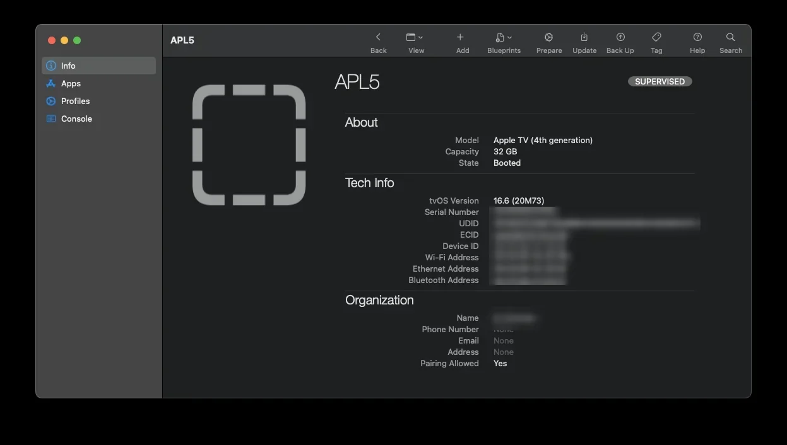

4. Select **Manual Configuration**, tick **Supervise devices** and **Allow devices to pair with other computers**, then select **Next**.

   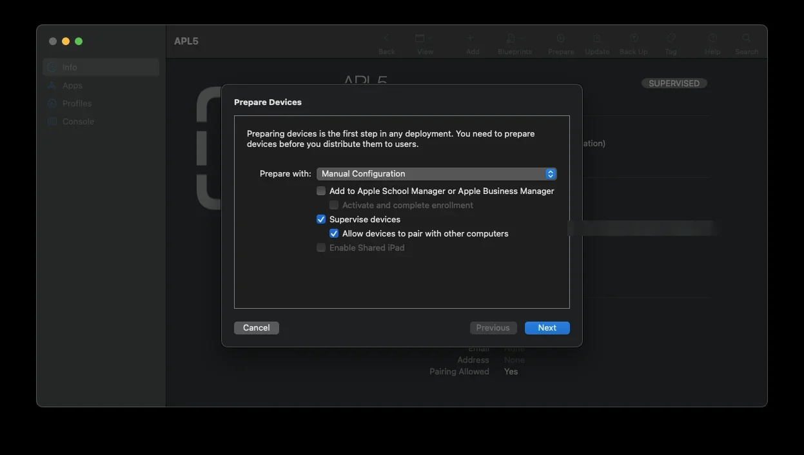

5. Select **Do not enroll in MDM**, then select **Next**.

   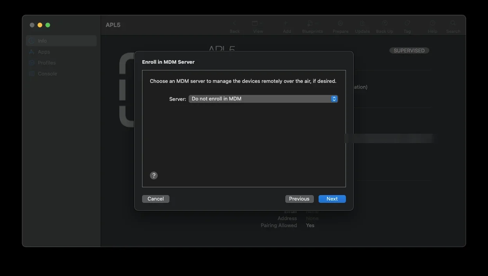

6. Select **Skip** when asked to sign in to Apple School Manager.
7. Create a new organisation (for example, `My_Org`), then select **Next**.

   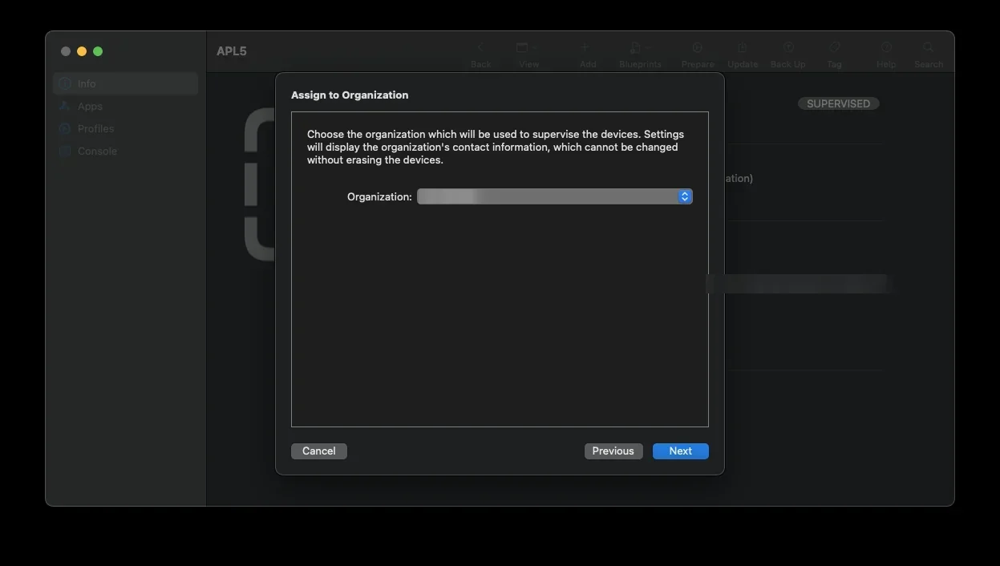

8. Select **Generate a new supervision identity**.
9. Select **Show all steps**, then select **Prepare**.

   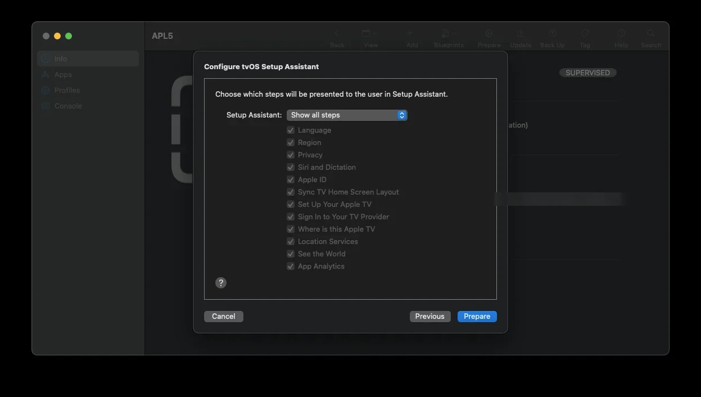

The Apple TV should now appear in the **Supervised** tab in Apple Configurator.

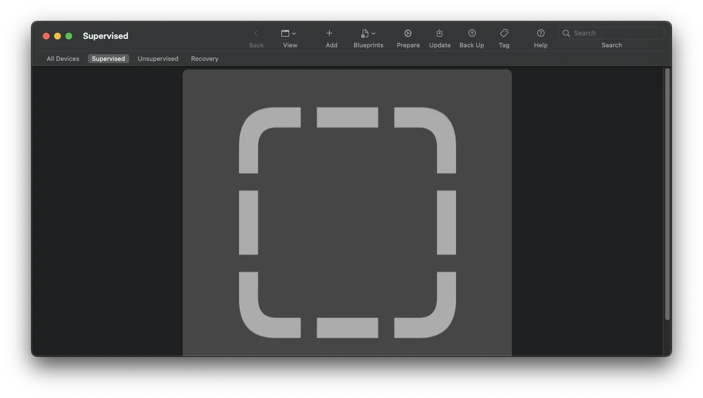

10. Go back to the Apple TV, which is still on the Hello screen, and complete the setup steps.

:::danger
**Download the app you want to test now.** Once the proxy profile below is installed, the Apple TV won't be able to connect to the App Store.
:::

:::tip
If the Apple TV keeps failing to become supervised, see [this Apple Developer Forums thread](https://developer.apple.com/forums/thread/89603).
:::

## Step 3: Create a profile with your Mac's IP and the Charles certificate

1. In Apple Configurator, select **File → New Profile**.

   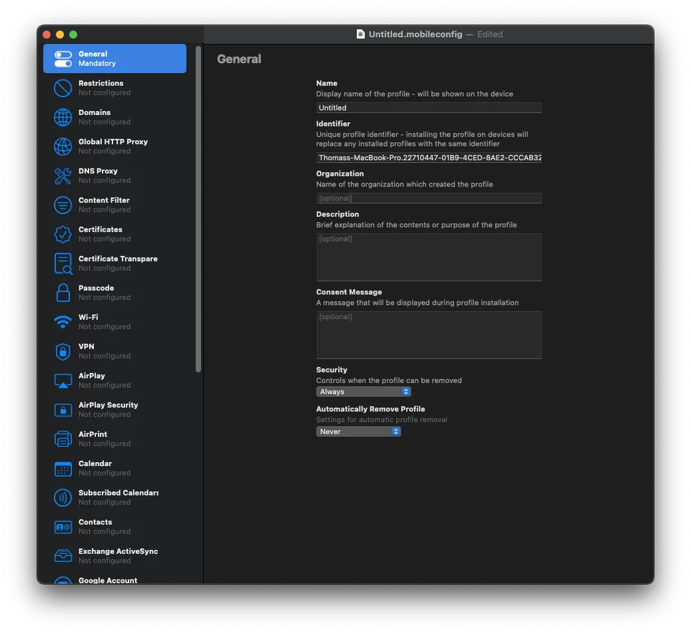

2. Select **Global HTTP Proxy**, select **Configure**, and enter your Mac's IP address with port `8888` (the default Charles port).

   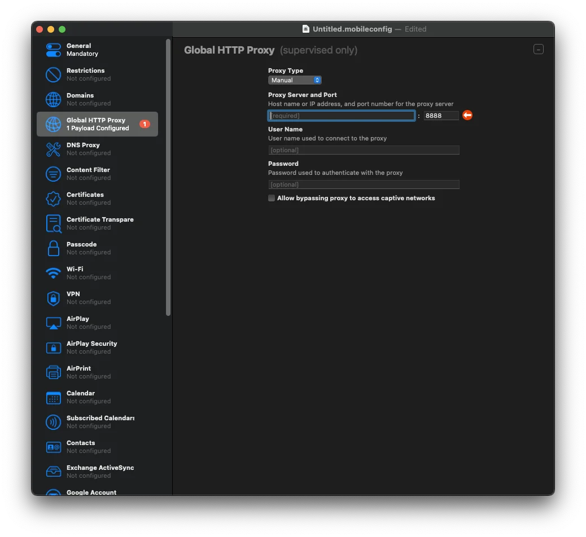

3. Select **Certificates**, select **Configure**, and add your saved Charles `.cer` file.

   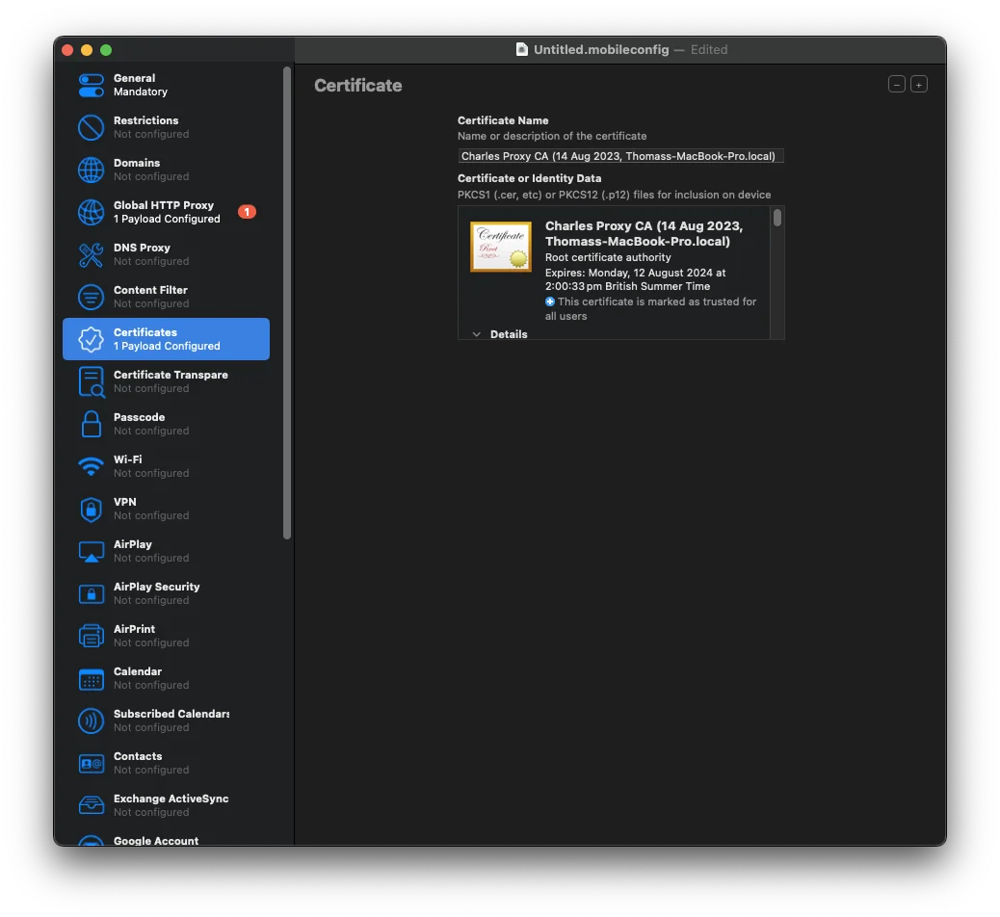

4. Select **File → Save**, give the profile a name, and close the profile window.

## Step 4: Install the profile and trust the certificate

1. In Apple Configurator, double-click the supervised Apple TV.
2. Select **Add → Profiles**, choose the profile you saved, and select **Add**.

   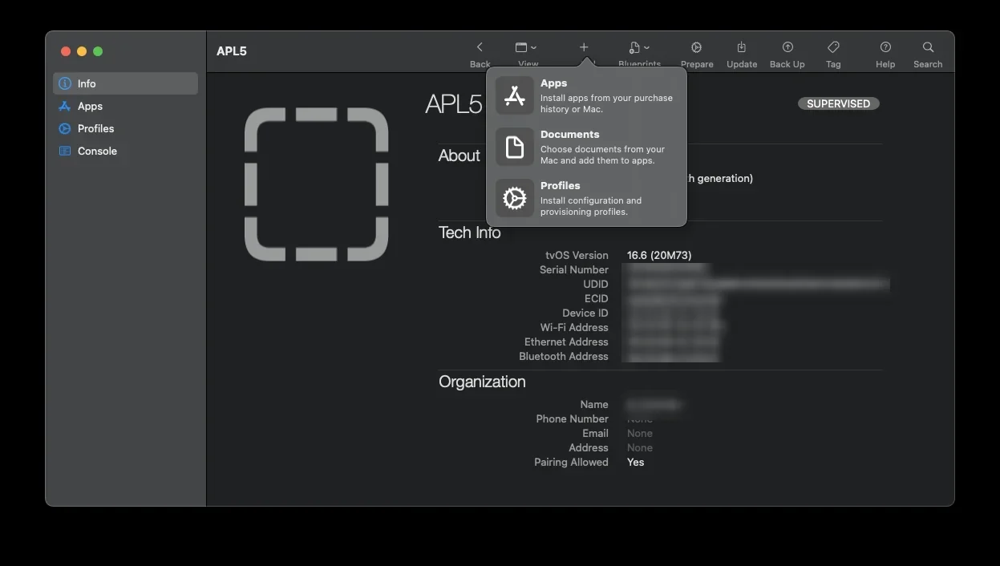

3. On the Apple TV, go to **Settings → General → About → Certificate Trust Settings**.
4. Turn on full trust for the Charles Proxy certificate.

   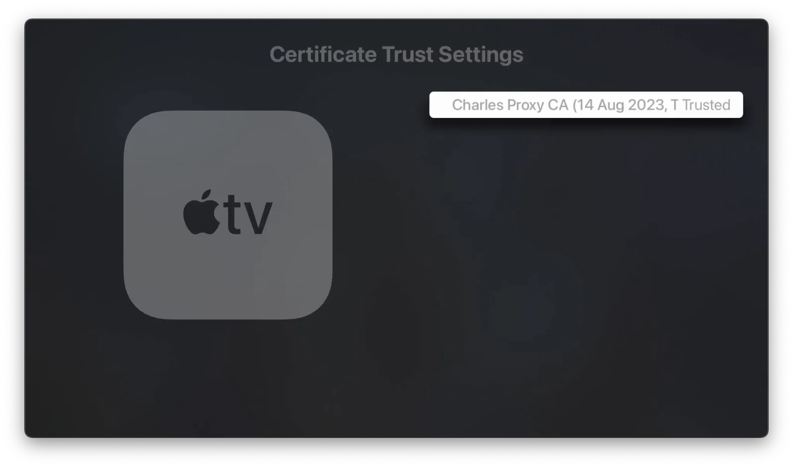

You should now see the Apple TV's traffic in Charles.

## Notes

- You only need to supervise the Apple TV once. In later sessions, you only need to install a profile.
- If your Mac moves to a different network, its IP address changes. Create and install a new profile with the new IP address.
- Apple's documentation: [Apple Configurator User Guide](https://support.apple.com/en-gb/guide/apple-configurator-mac/cada1ba9dab1/mac).
